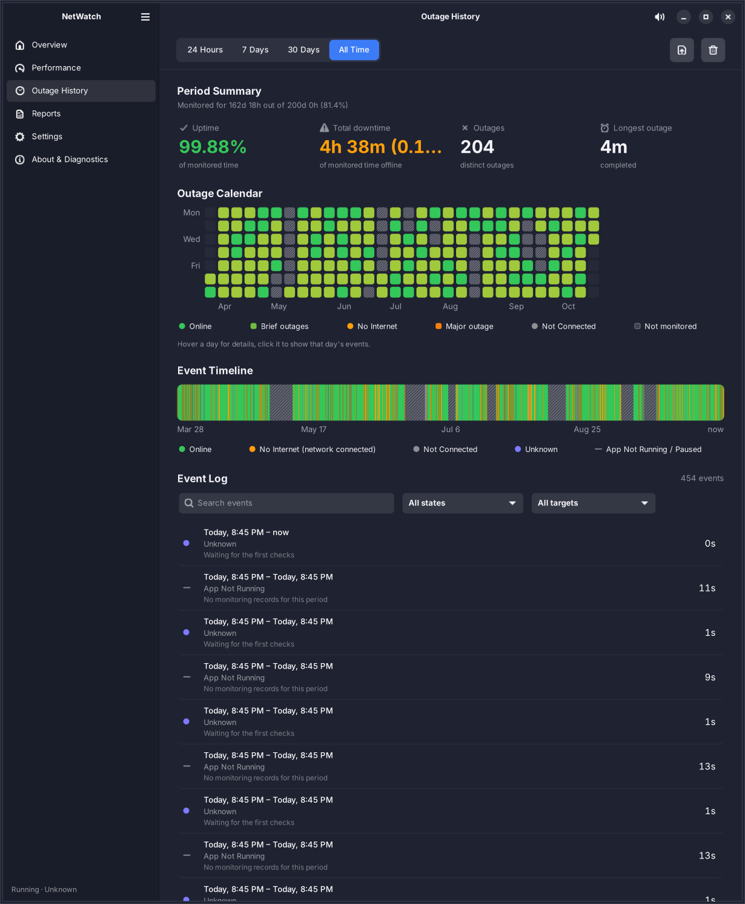
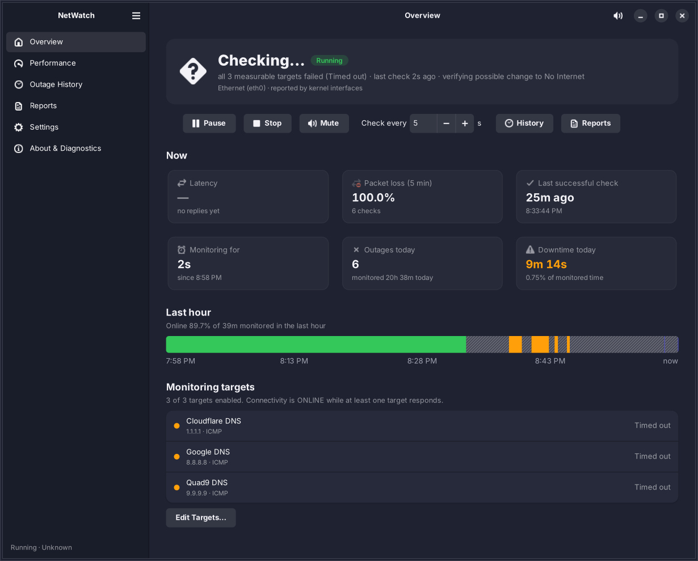
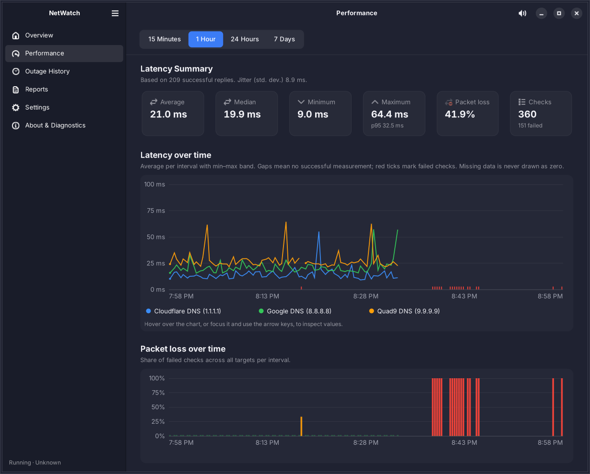
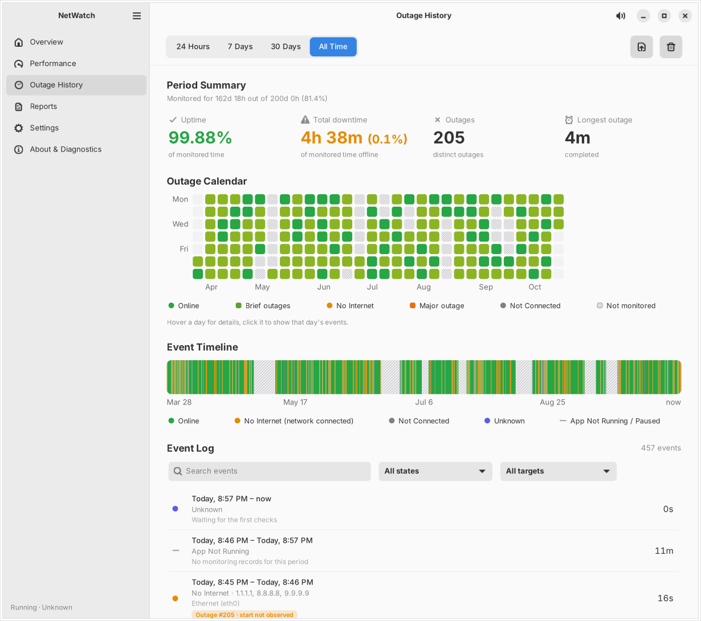

# NetWatch

NetWatch is a local-first network connectivity monitor for the Linux desktop. It checks your internet connection in the background, detects outages, measures latency and packet loss, and keeps a history you can explore and export. It is built with **Python 3, GTK 4, Libadwaita and SQLite**.

It does not need an account, a cloud service, an API key or a subscription. All data stays in a SQLite file in your home directory.



<sub>Screenshots use the synthetic demo database from `tools/seed_demo_db.py`.</sub>

| Overview | Performance | Light theme |
|---|---|---|
|  |  |  |

## Features

- **Separate states.** NetWatch keeps *No Internet* (the network is connected but internet targets fail) apart from *Not Connected* (no usable network) and from *App Not Running*, *Paused* and *Unknown* periods.
- **Outage History.** The screen follows the reference design: period selector (24 h, 7 days, 30 days, all time), period summary (uptime, downtime, outage count, longest outage, monitoring coverage), calendar heat map, event timeline, and a searchable, filterable event log with per-event details.
- **Overview.** Shows live status, the monitoring lifecycle, latency, 5-minute packet loss, today's outages and downtime, a last-hour timeline, per-target results, and Start/Pause/Resume/Stop/Mute controls.
- **Performance.** Latency and packet-loss charts for 15 minutes, 1 hour, 24 hours or 7 days, with average, median, min, max and p95 per target. Missing data is never drawn as zero.
- **Network names.** Every history entry and outage records the network you were connected to (the Wi-Fi name, or the wired connection's name). It shows in the event log, event details, calendar tooltips and reports, and the log can be filtered by network. Switching networks starts a new entry.
- **Reports.** TXT, CSV and HTML exports for the selected period, a single event, or the whole retained history. Each report states its coverage and the limitations of the data.
- **Alerts.**
  - A clearly audible alarm when the connection drops (it can repeat during an outage) and a chime when it comes back.
  - Choose between several built-in sounds (alarm, siren, beep, soft heartbeat) or use your own sound file (WAV, OGG, FLAC, MP3) for each event, and preview them in Settings. Volume is adjustable and muting never affects monitoring.
  - Desktop notifications.
- **Background operation.**
  - Closing the window keeps monitoring running.
  - Optional status icon (StatusNotifierItem).
  - Launch at login through XDG autostart.
  - Clean shutdown on Ctrl+Q and on SIGTERM.
- **Data safety.**
  - Versioned migrations and WAL mode.
  - Interrupted sessions are detected on the next start.
  - Clock changes and suspend/resume are detected.
  - A retention policy prunes raw measurements but keeps outage history.
  - Backup and restore use SQLite's backup API.

## Requirements

| Component | Minimum | Fedora | Debian / Ubuntu |
|---|---|---|---|
| Python | 3.10 | `python3` | `python3` |
| PyGObject | 3.42 | `python3-gobject` | `python3-gi` |
| pycairo bindings | – | `python3-cairo` | `python3-gi-cairo` |
| GTK | 4.12 | `gtk4` | `gir1.2-gtk-4.0` |
| Libadwaita | 1.4 | `libadwaita` | `gir1.2-adw-1` |
| ping | iputils | `iputils` | `iputils-ping` |
| SQLite | 3.24+ (bundled with Python) | – | – |

Libadwaita 1.4 means **Fedora 39+, Ubuntu 24.04+ and Debian 13 (trixie)+**. Debian 12 ships Libadwaita 1.2 and is not supported.

Optional components:

- **NetworkManager.** Lets NetWatch tell local disconnection apart from internet failure, and supplies Wi-Fi details. Without it, NetWatch falls back to `/sys/class/net` and the routing table.
- **A sound player.** Any of `pw-play` (pipewire-utils / pipewire-bin), `paplay` (pulseaudio-utils) or `aplay` (alsa-utils). Without one, alerts are silent.
- **`iw`.** Adds the Wi-Fi signal in dBm and the 802.11 standard.
- **A StatusNotifier host.** Needed for the status icon. KDE Plasma, XFCE, LXQt and Cinnamon have one. On GNOME, install the *AppIndicator and KStatusNotifierItem Support* extension.

```sh
# Fedora
sudo dnf install python3-gobject python3-cairo gtk4 libadwaita iputils
# Debian / Ubuntu
sudo apt install python3-gi python3-gi-cairo gir1.2-gtk-4.0 gir1.2-adw-1 iputils-ping
```

## Running from source

```sh
git clone <this repository> netwatch && cd netwatch
./bin/netwatch              # or: python3 -m netwatch
./bin/netwatch --background # start hidden, monitoring
./bin/netwatch --diagnostics  # headless: versions, network backend, one check per target
```

Other options: `--db PATH` uses another database file (handy for testing), `--debug` turns on verbose logging, and `--version` prints the version.

## Installing

**Debian/Ubuntu (quick binary package):**

```sh
make deb                         # builds build/netwatch_1.1.0-1_all.deb with dpkg-deb
sudo apt install ./build/netwatch_1.1.0-1_all.deb
```

**Debian source package:** run `cp -r packaging/debian debian && dpkg-buildpackage -us -uc -b`. This needs debhelper, dh-python and pybuild-plugin-pyproject.

**Fedora / RPM:**

```sh
sudo dnf install rpm-build make python3      # build tools (once)
make rpm                                     # builds build/rpm/RPMS/noarch/netwatch-1.1.0-1.fcNN.noarch.rpm
sudo dnf install ./build/rpm/RPMS/noarch/netwatch-*.noarch.rpm   # pulls in GTK4, Libadwaita, PyGObject, ...
```

`dnf install ./file.rpm` resolves and installs the dependencies (python3-gobject, python3-cairo, gtk4, libadwaita,
iputils) automatically. The package is tied to your Fedora release's Python version, so rebuild it after a
Fedora version upgrade. Remove it with `sudo dnf remove netwatch`.

**Manual install** (Python package plus desktop file, metainfo and icons):

```sh
sudo make install PREFIX=/usr
```

## Updating

Updating keeps your history, settings and targets. The database is upgraded automatically when NetWatch next starts.

**From 1.0.0 (first time):** unpack the new release and run its update script:

```sh
unzip netwatch-1.1.0.zip && cd netwatch
./update.sh
```

**Afterwards**, the `netwatch-update` command is installed. Point it at a newer release ZIP or folder:

```sh
netwatch-update ~/Downloads/netwatch-1.2.0.zip
netwatch-update --check ~/Downloads/netwatch-1.2.0.zip   # only compare versions
```

The command:

- detects how NetWatch was installed (`.deb`, `.rpm` or `make install`) and builds and installs the same kind of package. It asks for your password only for the install step.
- stops a running NetWatch cleanly and starts it again afterwards (`--no-restart` skips the restart).
- refuses to downgrade or reinstall the same version unless you pass `--force`.

Other options: `-y` skips the confirmation and `--method deb|rpm|make` overrides the detection. On Fedora it installs `rpm-build` first if needed.

## Using NetWatch

- **Overview.** Start, pause, resume or stop monitoring, mute alerts and change the check interval.
  - *Pause* records the time as an explicit "Monitoring Paused" period.
  - *Stop* closes the monitoring session.
  - Neither one deletes any history.
- **Outage History.**
  - Pick a period. Every metric, the calendar, the timeline and the log update together.
  - Hover a calendar day or timeline segment for details.
  - Click a day to filter the log to that day, or click a timeline segment to select that event in the log.
  - Each log row shows the network it belongs to. Use the network menu above the log to show only one network; the search box matches network names too. For a disconnection, the row shows the network that was lost.
  - Activate a log row to open its details: measurements, failure reasons, recovery evidence and an event export.
  - The share button exports a report for the period. The trash button deletes the selected event, the period, or all history, always after a confirmation dialog.
- **Reports.** Choose a range (including a custom date range) and a format, preview it, and export. The file chooser asks before overwriting an existing file.
- **Settings → Sound Alerts.** Pick the *Connection lost* and *Connection restored* sounds, press ▶ to preview them, or choose *Custom sound file…* and select a file. If a custom file later disappears, NetWatch falls back to the built-in sound.
- **Settings.** Changes are validated and saved explicitly with **Save**, and an unsaved-changes bar appears while edits are pending. Target edits are applied as soon as you confirm them.

### Keyboard shortcuts

| Key | Action |
|---|---|
| `Space` | Pause / resume monitoring (ignored while typing in a text field) |
| `M` | Mute / unmute alerts (ignored while typing) |
| `Ctrl+S` | Export a report |
| `Ctrl+O` | Outage History |
| `Ctrl+,` | Settings |
| `Ctrl+1` … `Ctrl+6` | Switch page |
| `Esc` | Close dialog / go back |
| `Ctrl+?` | Keyboard shortcuts window |
| `Ctrl+Q` | Quit (stops monitoring) |

## How connectivity is classified

Each check round runs every enabled target in parallel: ICMP ping by default, with DNS and HTTP(S) adapters also available. The local network status comes from NetworkManager, or from kernel interfaces as a fallback.

| Round result | Raw state |
|---|---|
| At least one target answered | **Online** |
| No answer, and the local network is definitely down | **Not Connected** |
| No answer, local network up or unknown | **No Internet** |
| Checks could not run at all (ping missing, permission denied) | **Unknown** (diagnostic) |

- A failing public IP alone never counts as a local disconnection.
- A state change is confirmed only after the configured number of consecutive rounds: the *failure threshold* (default 2) or the *recovery threshold* (default 2).
- A new state period starts at the first round that supported it. The moment of confirmation is stored separately as `detected_at`.
- One outage covers a whole failure period, however many checks fail during it.
- When monitoring starts during a failure, the outage is marked *start not observed*. When monitoring stops, pauses or is interrupted before recovery, the outage is marked *recovery not observed*.

The **monitoring lifecycle** (Stopped, Starting, Running, Paused, Error) is tracked separately from the connection state.

### Reliability calculation rules

All screens and reports use these rules, which are implemented in `netwatch/stats.py`:

- **Monitored time** is the total of Online, No Internet and Not Connected time.
- **Uptime %** is Online time divided by monitored time.
- **Downtime %** is No Internet plus Not Connected time, divided by monitored time.
- **App Not Running, Paused and Unknown** time count neither as uptime nor as downtime. They appear as coverage: "Monitored for X out of Y (Z%)".
- **Degraded connectivity** (high latency or partial loss while a target still answers) counts as *Online*. Connection quality is reported on the Performance page instead.
- **Outage durations** in a summary are clipped to the selected period. The longest outage is flagged as ongoing, completed, or recovery not observed.
- **Overlapping records** are trimmed so no instant is counted twice. Overlaps can happen after a backwards clock change.
- **Timestamps** are stored as UTC epoch seconds. Elapsed time uses the monotonic clock.
- **Suspend, resume and clock jumps** are detected by comparing the wall clock with the monotonic clock. The gap is recorded as unmonitored, never as continuous monitoring.
- **Crashes.** After a crash or a kill, the session is closed at its last committed heartbeat on the next launch. The time after that is shown as App Not Running.

## Data and files

| What | Where |
|---|---|
| Database | `$XDG_DATA_HOME/netwatch/netwatch.db` (default `~/.local/share/netwatch/`) |
| Database location override | `$XDG_CONFIG_HOME/netwatch/config.json`, `--db`, or `$NETWATCH_DB` |
| Log | `$XDG_STATE_HOME/netwatch/netwatch.log` |
| Generated sounds | `$XDG_CACHE_HOME/netwatch/sounds/` |
| Autostart entry (when enabled) | `$XDG_CONFIG_HOME/autostart/io.github.netwatch.NetWatch.desktop` |
| Reports (default folder) | `~/Documents/NetWatch Reports` |

The database schema has these tables:

- `settings`, `targets`, `schema_migrations`
- `monitoring_sessions`, `measurements`, `connection_states`
- `outages`, `outage_targets`, `application_events`

Deleted targets are soft-deleted so that history keeps its references.

## Architecture

```
netwatch/
  main.py               CLI entry point, logging, dependency check, --diagnostics
  models.py             ConnState, Lifecycle, ErrorCategory, CheckResult, ...
  settings.py           defaults, validation, thread-safe SettingsStore
  stats.py              reliability service (the single source of truth for uptime maths)
  reports.py            TXT / CSV / HTML report generation
  alerts.py             AlertManager (policy) + SoundPlayer (generated WAV, pw-play/paplay/aplay)
  notify.py             desktop notifications via GApplication
  tray.py               StatusNotifierItem + com.canonical.dbusmenu over Gio D-Bus
  autostart.py          XDG autostart entry
  paths.py              XDG directories
  storage/              db.py (connections, WAL, migrations, backup), migrations.py, repository.py (all SQL)
  monitor/              engine.py (worker thread, sessions), classifier.py (pure state machine),
                        adapters.py (ICMP/DNS/HTTP), netstate.py (NetworkManager / sysfs), process.py
  ui/                   application.py, window.py, pages/*, widgets/* (Cairo timeline, calendar, charts)
```

The threading model works like this:

- **Monitoring.** The engine runs on one worker thread. Per-target checks go through a bounded pool of 8 threads, and ping subprocesses are tracked and killed on shutdown.
- **UI work.** Database-heavy work for the UI (history aggregation, reports, backups) runs on a two-thread pool. Results come back to the GTK main loop via `GLib.idle_add`.
- **SQLite.** Each thread has its own connection, and WAL mode lets the UI read while the engine writes. Writes go through a lock and `BEGIN IMMEDIATE` transactions.
- **Event log.** Only a window of rows is ever built, so jumping to the oldest of 20,000+ events stays instant.

Why there is no libappindicator: it is GTK 3-only and cannot be loaded into a GTK 4 process. NetWatch therefore implements the StatusNotifierItem D-Bus protocol directly. If no StatusNotifier host is present, it says so in Settings and in About & Diagnostics. You can reopen the window by launching NetWatch again, which activates the running instance.

## Testing

The tests need **pytest**. Install it from your distribution so it uses the same Python as PyGObject:

```sh
# Fedora
sudo dnf install python3-pytest
# Debian / Ubuntu
sudo apt install python3-pytest
# GUI tests additionally need Xvfb and D-Bus (skipped automatically if missing)
sudo dnf install xorg-x11-server-Xvfb dbus-daemon     # Fedora
sudo apt install xvfb dbus                            # Debian / Ubuntu

make test          # or: python3 -m pytest -q
```

On distributions that block `pip install` into the system Python (PEP 668), you can use a virtual environment that
can still see the system GTK bindings: `python3 -m venv --system-site-packages .venv && .venv/bin/pip install pytest
&& make test PYTHON=.venv/bin/python`.

The suite has 59 tests and needs no internet connection, because network checks are mocked:

- `tests/test_engine.py` covers the state model and engine:
  - online and partial-failure handling, threshold behaviour, recovery durations, no duplicate outages
  - Not Connected vs No Internet, missing dependency and permission diagnostics
  - pause, stop and interrupted-session recovery, clock jumps
  - thread shutdown with no orphaned `ping` processes
- `tests/test_stats_reports.py` covers:
  - the uptime denominator, period changes, calendar days built from real records, timeline-to-outage linking, overlaps, the empty state
  - reports with partial coverage and unobserved outage starts, the CSV BOM
  - migrations, backup and restore, rejecting a newer schema, retention
  - settings validation and persistence, large-history performance, deletes
- `tests/test_alerts_adapters.py` covers:
  - alert repeat, mute and unmute policy, and graceful behaviour with no sound backend
  - ping output parsing, the sysfs fallback, Wi-Fi parsing
- `tests/test_gui.py` drives the **real GTK application** under `xvfb-run` and `dbus-run-session`:
  - period switching updates every view; timeline and calendar selection; event-log filters
  - event details; settings validation and save
  - monitoring while hidden and muted; pause and resume from the UI
  - the tray menu over D-Bus against a fake StatusNotifierWatcher, and normal monitoring with no tray at all
  - the empty-history state; responsiveness with 21,000 events
  - clean exit with no threads or subprocesses left behind

  These tests are skipped automatically if Xvfb, D-Bus or GTK are unavailable.

Developer tools:

- `tools/seed_demo_db.py PATH` creates a **synthetic** demo database. It refuses to overwrite existing files.
- `tools/screenshot.py --db PATH --out DIR` renders each page to PNG, and works headless under Xvfb.

### Manual verification checklist (real desktop session)

These need a real session and network, which an automated container cannot provide:

1. Unplug the cable or switch off Wi-Fi. Within *interval × failure threshold* the status should show **Not Connected**, the alarm sound should play, and a notification should appear.
2. Keep Wi-Fi associated but block the internet, for example by unplugging the router's WAN link or running `sudo ip route del default`. The status should show **No Internet**.
3. Restore the connection. You should hear the recovery chime and get a "Connection restored" notification with the outage duration.
4. Close the window. Monitoring should continue, and the status icon should appear if a StatusNotifier host is present. Use the icon's menu to reopen the window, mute, or quit.
5. Enable *Launch at login*, then log out and back in. NetWatch should start hidden and monitoring.
6. Run `kill -9` on the process, then relaunch. A banner should explain the interrupted session, and the gap should appear as App Not Running.
7. Export each report format and open it. HTML should render offline, and CSV should open in LibreOffice Calc.

## Troubleshooting

- **"Required tool missing" or Unknown state.** Install `iputils` (Fedora) or `iputils-ping` (Debian/Ubuntu).
- **"Permission denied".** Your `ping` cannot open ICMP sockets. Check `sysctl net.ipv4.ping_group_range` or the `cap_net_raw` file capability on `ping`.
- **No internet but browsing works.** Your network may block ICMP. Add an HTTP(S) target such as `https://example.com` in Settings → Targets.
- **No status icon on GNOME.** Install the AppIndicator extension, or reopen NetWatch from the app grid.
- **No sound or too quiet.** Install `pipewire-utils`/`pipewire-bin` or `pulseaudio-utils`. In Settings → Sound Alerts, raise the volume, pick *Alarm* or *Siren*, and press ▶ to preview. Also check that the system output volume is not muted.
- **Charts are blank, or startup fails with "Cairo support".** Install `python3-gi-cairo` (Debian/Ubuntu) or `python3-cairo` (Fedora).
- **Inspect the environment.** Run `netwatch --diagnostics`, or open *About & Diagnostics* and use **Copy Diagnostics**.

## Limitations

- Every reported time is a detection time, accurate to about one check interval. Brief failures shorter than *interval × failure threshold* are not reported as outages.
- Wi-Fi details depend on what NetworkManager or `iw` expose. Fields that cannot be observed are omitted, never guessed.
- Monitoring runs in the user session (no system daemon). It stops while the user is logged out, and that time is shown as App Not Running.
- The DEB package was built, installed, launched and removed in the development environment. The RPM was built there and installed, verified and removed with Fedora 41's `rpm` in a container. Fedora package mirrors were unreachable, so the app was not launched on Fedora itself and `dnf` dependency resolution was not exercised.

## License

MIT. See [LICENSE](LICENSE).
