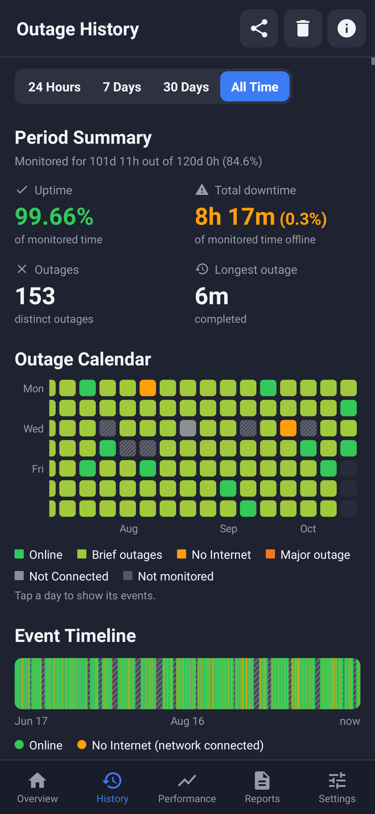
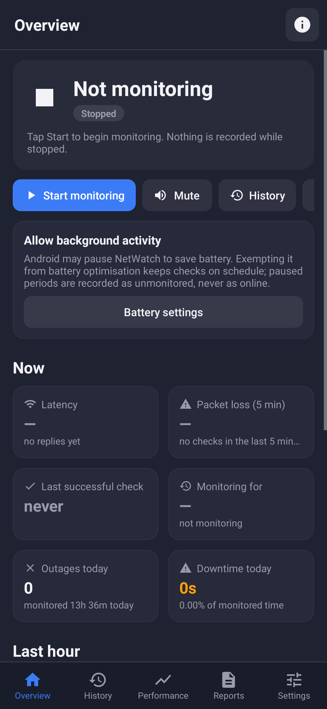
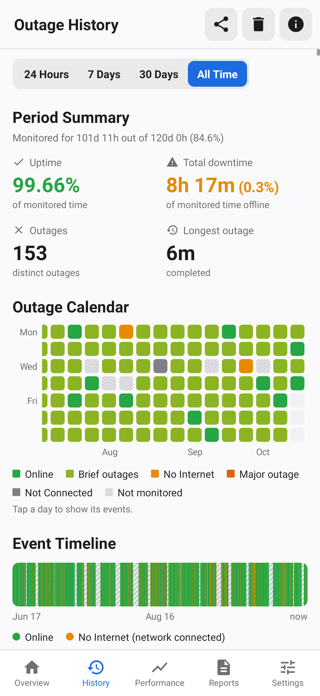
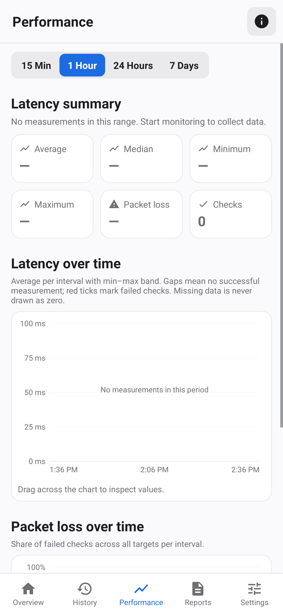

# NetWatch for Android

The Android version of NetWatch: the same state model, reliability rules, database schema and reports as the
Linux app, as a native Kotlin app. Monitoring runs in a foreground service, so it keeps going while the app is in
the background.

| History (dark) | Overview | History (light) | Performance |
|---|---|---|---|
|  |  |  |  |

<sub>Rendered from the real app under Robolectric with synthetic demo history.</sub>

## Install

The release ZIP includes `netwatch-1.0.0.apk`. Copy it to your phone, open it and allow "Install unknown apps"
for your file manager when Android asks. Requires **Android 8.0 (API 26) or newer**.

The APK is signed with a locally generated key. If you build it yourself on another machine, uninstall the old
copy first, because Android refuses updates signed with a different key. Uninstalling also deletes the history,
so make a backup first (Settings → Data → Back up).

## Features

- **Overview.**
  - Live status: Online, No Internet, Not Connected or Checking, plus the lifecycle (Running, Paused, Stopped).
  - Latency, 5-minute packet loss, last successful check, today's outages and downtime.
  - A last-hour timeline and per-target results.
  - Start/Pause/Resume/Stop and Mute.
- **Outage History** (as in the reference design):
  - 24 h / 7 days / 30 days / all-time selector.
  - Period summary with monitoring coverage.
  - Calendar heat map: tap a day to filter the log.
  - Event timeline: drag to inspect, tap to select the event.
  - Searchable, filterable event log with details: measurements, failure reasons, recovery evidence.
  - Delete an event, a period or everything, always after confirmation.
- **Performance.** Latency and packet-loss charts (15 min to 7 days), average/median/min/max/p95, and a
  per-target table. Missing data is never drawn as zero.
- **Reports.** HTML, CSV and TXT for a period, a custom date range or a single event. Save them with the system
  file picker (never silently overwrites) or share them to any app.
- **Alerts.**
  - The same soft heartbeat sound, with optional repeat and recovery chime, plus vibration.
  - Notifications for outage, recovery and monitoring problems.
  - Mute from the app or straight from the monitoring notification.
- **Background.**
  - Foreground service with Pause/Resume/Mute/Stop actions in its notification.
  - Optional start after reboot.
  - The system restarts the service if it kills the app; the gap is recorded as unmonitored.
- **Settings.** Interval, timeout, thresholds, targets (ICMP, TCP host:port, DNS, HTTP), sounds, notifications,
  theme (system/light/dark), retention, backup and restore. Changes are validated and saved explicitly.

## How Android affects monitoring

NetWatch never claims monitoring it did not do:

- **Deep sleep, Doze and stopped processes.** The engine compares the wall clock with `elapsedRealtime`. If no
  check ran for longer than expected, the gap is recorded as unmonitored, not as online.
- **Blocked network access.** When Android blocks the app's network access (Doze, Data Saver), the probe reports
  it and the state becomes *Unknown*, never a fake "No Internet" outage.
- **Battery optimisation.** Exempting NetWatch keeps checks on schedule. A card on Overview and the Settings
  screen link to the system page.
- **Wakelock.** A partial wakelock keeps checks running while the screen is off. Expect some battery use; a
  longer interval reduces it.
- **No location permission.** NetWatch does not request location, so Android hides the Wi-Fi network name. The
  other Wi-Fi details (channel, band, standard, signal) are shown when Android provides them.
- **ICMP.** It uses the system `ping`. Some carriers block ICMP, which is why a TCP target (`1.1.1.1:443`) is
  included by default. Any responding target counts as online.

## Build

You need a JDK (17+), Gradle (or the included wrapper) and an Android SDK with `platforms;android-35` and
`build-tools;35.0.1`. The build does **not** use the Android Gradle Plugin or Google's Maven repository. Gradle
compiles Kotlin against `android.jar` and drives `aapt2`, R8, `zipalign` and `apksigner` from the SDK directly,
so only the SDK and Maven Central are needed.

```sh
sdkmanager "platforms;android-35" "build-tools;35.0.1"
echo "sdk.dir=$HOME/Android/Sdk" > local.properties      # or set ANDROID_HOME
./gradlew :app:assembleApk                                 # → app/build/apk/netwatch-1.0.0.apk
./gradlew :app:test                                        # 40 JVM/Robolectric tests
adb install -r app/build/apk/netwatch-1.0.0.apk
```

A signing key is generated on first build in `keystore/` (not committed).

## Tests

`./gradlew :app:test` runs 40 tests without a device:

- **Core (33 tests, plain JVM, real SQLite through JDBC).**
  - State model: online, partial failure, thresholds, single outage, recovery duration.
  - Not Connected vs No Internet, system-blocked network → Unknown, missing ping.
  - Pause, stop, interrupted session after a kill, deep-sleep gap, clock change.
  - Statistics, calendar from real records, overlap trimming, empty history.
  - Reports with partial coverage, migrations, retention, settings validation, large-history performance.
  - Alert policy.
- **UI (7 tests, Robolectric, Android 15 runtime).**
  - The real `MainActivity` with every screen.
  - History period switching, timeline/event linking, empty state.
  - Foreground service start/pause/resume/stop.
  - Screenshots in light and dark (saved to `app/build/screenshots/`).

  Robolectric's few `androidx.test` dependencies live on Google Maven, so `src/testShim/` contains minimal
  test-only stand-ins. They are never packaged in the APK.

## Not verified

No Android device or hardware-accelerated emulator was available where this was built. The app was exercised
under Robolectric, which runs the real Android framework code on the JVM, but these need a real phone:

- real ping/TCP behaviour on Wi-Fi and mobile data
- Doze timing and OEM battery managers
- notification appearance and sound output
- boot start
- file picker and share flows

Checklist for a phone:

1. Install, open, allow notifications, tap **Start monitoring**. The status should show *Online* within one interval.
2. Turn on airplane mode. You should get *Not Connected*, the heartbeat sound and a notification.
3. Connect to Wi-Fi without internet (or unplug the router's WAN). You should get *No Internet*.
4. Restore the connection. You should hear the recovery chime and see "Connection restored".
5. Lock the phone for 30+ minutes, then check History. Any gaps should appear as unmonitored, not online.
6. Export each report format and share one by e-mail.
7. Back up, restore, and confirm the history is intact.

## Licences

MIT. Icons are Material Design icons (Apache License 2.0).
